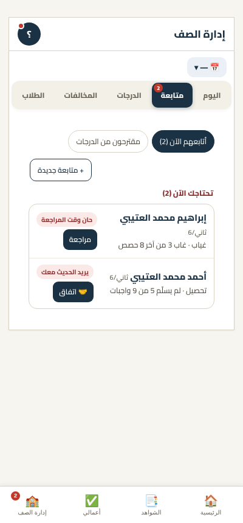
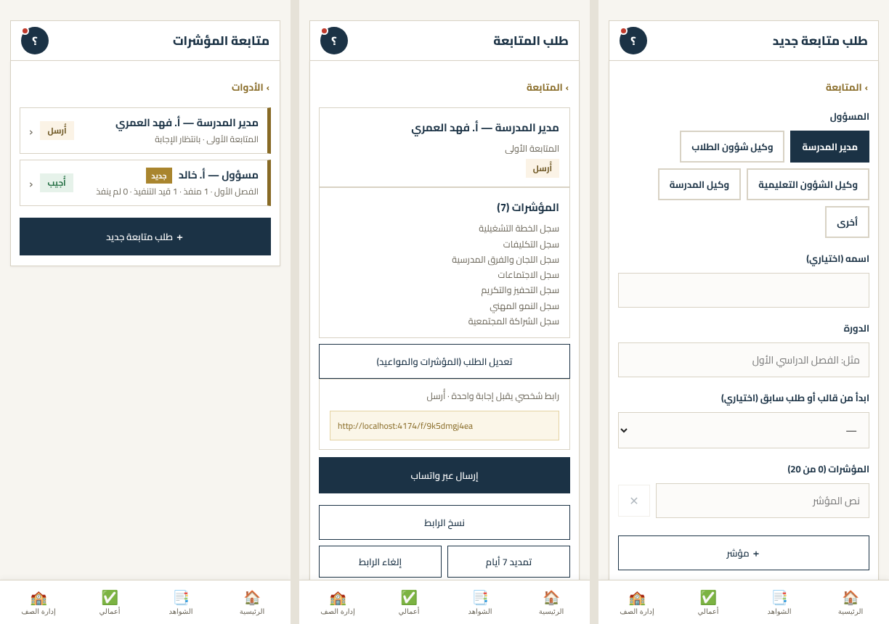
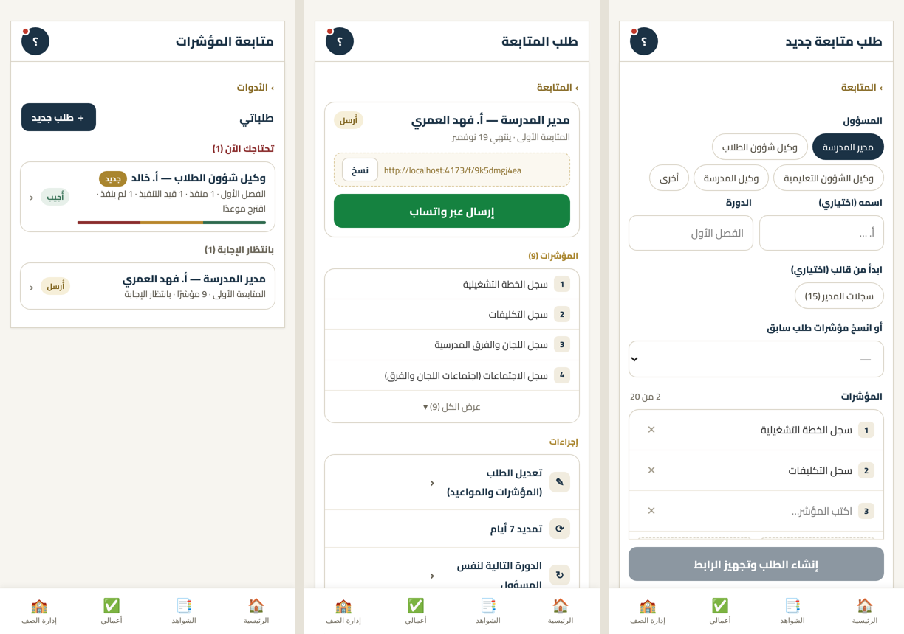

# مرجع هوية واجهة التطبيق (شاهد على الأداء الوظيفي)

> **معتمد من المستخدم (2026-11-12)، الإصدار 3.48.** هذا الملف هو المرجع الوحيد لشكل **شاشات التطبيق**: ألوانها وزواياها
> وعناصرها وقواعد استعمالها. يبدأ به الذكاء الاصطناعي قبل بناء أي شاشة جديدة أو تعديل شكل شاشة قائمة.
>
> **النطاق: الشاشات فقط.** التقارير (المطبوعة وPDF) لها هوية أخرى (خط الوزارة وترويستها) ومرجعها `REPORTS.md` —
> لا تُطبَّق هذه الهوية على التقارير، ولا تُستعمل متغيّرات `--ui-*` في أصنافها.

- **الأصل:** «إدارة الصف» (تبويب «متابعة» خصوصًا) — منه أُخذت اللغة البصرية.
- **أول تعميم:** «الأدوات» (متابعة المؤشرات + الاستبانات)، الإصدار 3.48.
- **ملف فيجما:** [هوية شاهد — الأدوات](https://www.figma.com/design/KMgCIQqXcI6Xyyd4NFp1RO) — نفس الألوان كمتغيّرات (`شاهد / ألوان`، `شاهد / زوايا`) والعناصر كمكوّنات (Pill، Chip، ListRow، MenuItem، IndicatorRow) و4 شاشات مرجعية.
- **في الكود:** المتغيّرات بأعلى قسم الهوية في `style.css` (`:root` بـ`--ui-*`)، والعناصر بأصناف `tlx-*` بعدها.

| المرجع (إدارة الصف) | قبل | بعد |
|---|---|---|
|  |  |  |

---

## 1. الأساس

**الخط:** Cairo للواجهة كلها (الأوزان 400/600/700/800). العنوان الكبير 15–17 بوزن 800، نص الصف 14 بوزن 800، النص الثانوي 12، الشارة 10.5 بوزن 700.

**الألوان الأساسية** (موجودة قبل الهوية، أعلى `style.css`):

| المتغيّر | القيمة | الاستعمال |
|---|---|---|
| `--navy` | `#1B3245` | الزر الرئيسي، العناوين، المختار |
| `--gold` / `--gold-text` | `#A9852E` / `#876A25` | عناوين الأقسام الصغيرة / روابط الرجوع (`--gold-text` للنص لأنه أوضح تباينًا) |
| `--paper` | `#F7F5F0` | خلفية الصفحة |
| `--card` | `#FFFFFF` | البطاقات والصفوف |
| `--line` | `#D8D2C4` | حدود البطاقات والحقول |
| `--ink` / `--muted` | `#232323` / `#6B6659` | النص / النص الخافت |

**ألوان الواجهة** (`--ui-*`):

| المتغيّر | القيمة | المعنى |
|---|---|---|
| `--ui-danger` / `-bg` | `#8A2C2C` / `#FBE9E7` | تحتاجك الآن، حذف، لم ينفذ، انتهى |
| `--ui-ok` / `-bg` | `#2F6B4F` / `#E7F0EA` | منفّذ، أُجيب، مفتوحة |
| `--ui-warn` / `-bg` | `#7A5E16` / `#F6EFD9` | أُرسل، قيد التنفيذ |
| `--ui-neutral` / `-bg` | `#5C584D` / `#EEEAE0` | منتهٍ، مغلقة |
| `--ui-info-bg` | `#EEF3FB` | معلومة (نصها كحلي) |
| `--ui-wip` | `#B8862B` | شريط «قيد التنفيذ» |
| `--ui-whatsapp` | `#158240` | زر واتساب فقط |
| `--ui-divider` | `#EEE9DF` | الخط بين الصفوف داخل البطاقة |
| `--ui-hover` | `#FAF8F3` | الصف عند المرور |
| `--ui-icon-bg` | `#F1ECDF` | مربع الأيقونة والرقم |
| `--ui-track` / `--ui-tab-ink` | `#F3F0E8` / `#6B6457` | خلفية شريط التبويبات / نص غير المختار |
| `--ui-body` | `#4A4539` | النص الثانوي داخل الصفوف |
| `--ui-note-bg` / `-line` / `-ink` | `#FBF6E8` / `#E4D3A2` / `#5E4A16` | ملاحظة هادئة («تتجمّد الأسئلة…») |
| `--ui-link-bg` / `-line` | `#FBF8F0` / `#D9C79A` | صندوق الرابط المنقّط |
| `--ui-add-bg` | `#FBFAF6` | أزرار الإضافة المنقّطة |
| `--ui-x` / `--ui-switch-off` | `#A39C8C` / `#CFC9BC` | زر ✕ الخفيف / المفتاح المطفأ |

**الزوايا:** البطاقة `--ui-r-card` (14)، الزر الكبير والحقل `--ui-r-btn` (11)، الشارة والكبسولة `--ui-r-pill` (دائرية). الأزرار الصغيرة 8–10، ومربع الأيقونة 10، ومربع الرقم 6.

> **قاعدة:** لا لون جديد مكتوب كرقم داخل عنصر. إن احتجت لونًا غير موجود أضفه متغيّرًا هنا وفي `:root` أولًا، ثم استعمله.

---

## 2. العناصر (`style.css`، أصناف `tlx-*`)

> الاسم `tlx-` تاريخي (بدأت الهوية في «الأدوات»)، لكنه **هوية التطبيق كله**: يُستعمل في أي شاشة. لا يُعاد تسميته
> (معرّفات داخلية — CLAUDE.md «تعديلات العناوين»).

| العنصر | الصنف | متى |
|---|---|---|
| رابط الرجوع | `tlx-crumb` (أو `toolsBackLink()`) | أعلى كل شاشة فرعية: «› القسم الأب» |
| رأس القائمة | `tlx-head` + `tlx-new` | عنوان القائمة وزر «＋ جديد» صغير بجانبه |
| عنوان مجموعة | `tlx-grp` (أحمر) / `tlx-grp is-calm` | «تحتاجك الآن (2)» بالأحمر، والباقي هادئ؛ مع العدد بين قوسين |
| عنوان قسم صغير | `tlx-sec` | «المؤشرات (15)»، «إجراءات» — ذهبي صغير |
| بطاقة مجمّعة | `tlx-box` | تجمع صفوفًا متشابهة بخطوط فاصلة؛ لا صندوق لكل عنصر |
| صف قائمة | `tlx-row` (+`tlx-row-main` و`tlx-chev`) | عنصر يُفتح: عنوان + سطر ثانوي + شارة + ‹ |
| شارة حالة | `tlx-pill` + `is-red/is-ok/is-gold/is-blue` | حالة قصيرة («أُرسل»، «منفّذ»)؛ `is-new` للجديد |
| شريط تقدّم | `tlx-mini` (`m-ok/m-wip/m-no`) | تحت الصف لتوزيع منفّذ/قيد/لم ينفذ |
| بطاقة علوية | `tlx-hero` | رأس شاشة التفاصيل: العنوان والحالة والإجراء الرئيسي |
| زر | `tlx-btn` + `is-navy/is-wa/is-ghost` | `is-navy` للرئيسي، `is-wa` لواتساب فقط، `is-ghost` للثانوي |
| قائمة إجراءات | `tlx-mi` (+`is-danger`) داخل `tlx-box` | الإجراءات الثانوية بأيقونة؛ الخطِر بالأحمر وفي الآخر |
| صف مرقّم | `tlx-ind` + `tlx-n` | مؤشرات/خيارات/مواعيد، ويحمل حقل كتابة عند التحرير |
| إضافة | `tlx-add` | «＋ مؤشر»، «＋ موعد» منقّطة في آخر البطاقة |
| كبسولات اختيار | `tlx-chips` + `tlx-chip` (`is-on`) | اختيار من قائمة قصيرة؛ `tlx-scroll` لصف أفقي طويل |
| خيارات كبيرة | `tlx-opts` (`tlx-opts3`) + `tlx-opt` | اختيار بين 2–4 مع وصف قصير |
| شريط مقسّم | `tlx-seg` | خيار واحد من 2–4 قصيرة (المدة: 7/14/30) |
| حقل | `tlx-inp`، وعنوانه `tlx-lbl` | `tlx-two` لحقلين بسطر |
| زر ثابت أسفل | `tlx-cta` | زر الحفظ/الإنشاء في النماذج الطويلة؛ يبقى فوق الشريط السفلي |
| ملاحظة | `tlx-note` | تنبيه هادئ قصير |
| أرقام مختصرة | `tlx-strip` | 3 أرقام متجاورة (منفذ/قيد/لم ينفذ) |
| بطاقة أداة | `tlx-grid` + `tlx-card` + `tlx-ic` | بلاطات الدخول بأيقونة خطية (SVG) |
| حالة فارغة | `tlx-box tlx-empty` | أيقونة + عنوان + سطر يشرح الخطوة الأولى |

---

## 3. القواعد

1. **زر رئيسي واحد بارز في كل شاشة** (كحلي، أو أخضر إن كان الإرسال بواتساب). باقي الإجراءات قائمة (`tlx-mi`) أو أزرار صغيرة — لا صفّ أزرار كبيرة بنفس الوزن.
2. **المتشابه يُجمَع:** صفوف داخل بطاقة واحدة بخط فاصل، لا صندوق مستقل لكل عنصر.
3. **الترتيب بالأولوية:** ما يحتاج المعلم الآن أولًا بعنوان أحمر وعدد، ثم الباقي بعناوين هادئة.
4. **الحذف والإلغاء بالأحمر وفي آخر القائمة**، بعيدًا عن الإجراء الرئيسي (والحذف نفسه يمرّ بالسلة — `DELETE-POLICY.md`).
5. **لا إيموجي في الواجهة الجديدة:** أيقونات خطية SVG (سماكة 1.8، لون كحلي) داخل مربع `--ui-icon-bg`.
6. **القوائم الطويلة تُختصر:** أول 4 + «عرض الكل (n)».
7. **الاختيار من قائمة قصيرة بكبسولات** لا بقائمة منسدلة؛ المنسدلة للقوائم الطويلة المتغيّرة فقط.
8. **الحالة شارة صغيرة ملوّنة** بالمعاني في القسم 1 — نفس اللون لنفس المعنى في كل التطبيق.
9. **النماذج الطويلة:** زر الحفظ ثابت أسفل (`tlx-cta`)، والملاحظة الشارحة فوقه لا داخله.
10. **حدود الضغط:** 36px على الأقل للأزرار الصغيرة، 44px+ للرئيسية.

---

## 4. طريقة نقل قسم إلى الهوية

1. **صوّر القسم قبل** (Playwright بقاعدة وهمية داخل الصفحة كما في `tests/e2e/followups-ui.spec.js`، عرض 400).
2. **غيّر دوال الرسم والتنسيق فقط:** لا تمسّ الحفظ ولا الحذف ولا الاستعلامات ولا أسماء الدوال ولا `id` الحقول التي يقرأها الكود أو الاختبارات.
3. **استعمل عناصر القسم 2 والمتغيّرات**؛ أي عنصر جديد يُضاف هنا أولًا (ومكوّنًا في فيجما إن كان متكرّرًا).
4. **احذف التنسيق القديم** الذي لم يعد يستعمله شيء (ابحث بالاسم في `app/` و`index.html` قبل الحذف).
5. **صوّر بعد** وقارن، وشغّل الاختبارات؛ واكتب اختبارًا لكل حماية مسّها التغيير (تعطيل الأزرار أثناء العملية، التهريب).
6. **حدّث جدول «الأقسام المطبّقة» أدناه.**

---

## 5. الأقسام المطبّقة

| القسم | الحالة | الإصدار |
|---|---|---|
| إدارة الصف | الأصل (منه أُخذت الهوية؛ أصنافه `crm-*`/`fu-*` لم تُنقل لـ`tlx-*`) | — |
| الأدوات: الصفحة الرئيسية، متابعة المؤشرات، الاستبانات (القائمة، الإنشاء، الأسئلة، المستلمون) | مطبّقة | 3.48 |
| نافذة الاستبانة (الإرسال والنتائج) | تنسيق مدوّر فقط فوق أصناف `sv-*` | 3.48 |
| صفحة الرابط العامة للمسؤول `/f/` (`api/f.js`) | مطبّقة بنسخة مستقلة من الألوان داخل الصفحة (CSS مضمَّن بـnonce، بخط الجهاز لأن CSP يمنع الخطوط الخارجية) | 3.49 |
| صفحة الاستبانة العامة `/s/` (`api/s.js`) | لم يُبدأ | — |
| باقي التطبيق | لم يُبدأ | — |
